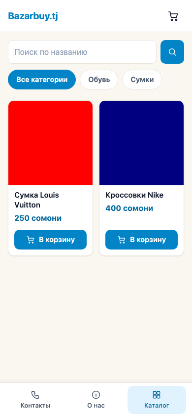
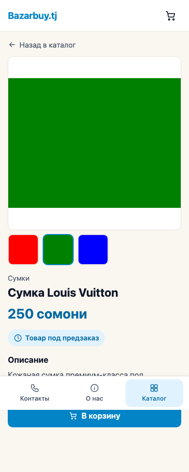
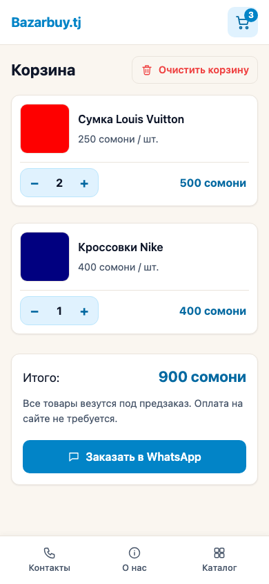
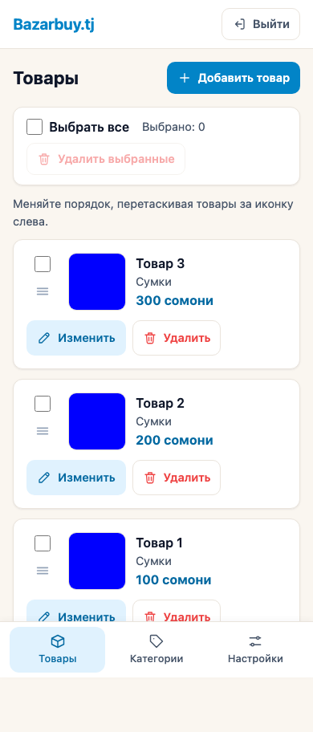

# Bazarbuy.tj

[](https://github.com/rmarufs/bazarbuy/actions/workflows/ci.yml)

**Демо: [bazarbuy.onrender.com](https://bazarbuy.onrender.com)**

Каталог товаров с оформлением предзаказа через WhatsApp, без онлайн-оплаты. Покупатель собирает корзину на сайте и отправляет готовое сообщение с заказом владельцу в WhatsApp. Сайт и админ-панель адаптивны: удобно пользоваться и с телефона, и с компьютера (приоритет у мобильной версии). Валюта — сомони (TJS). Подробная спецификация: [`docs/SPEC.md`](docs/SPEC.md).

## Как это устроено

Проект развёрнут как три отдельных сервиса, каждый отвечает за своё:

| Сервис | Для чего используется |
| --- | --- |
| **Render** | хостинг приложения (FastAPI) |
| **Supabase** | база данных PostgreSQL |
| **Cloudinary** | хранение и раздача фотографий товаров |

```text
Браузер → Render (FastAPI) → Supabase (PostgreSQL)
                           → Cloudinary (фото товаров)
```

Схема базы создаётся миграциями Alembic. Код проверяется тестами (pytest и Playwright), которые автоматически запускаются в GitHub Actions при каждом изменении.

## Возможности

### Покупатель (без регистрации)
- **Каталог:** карточки товаров, фильтр по одной категории.
- **Поиск по названию:** без учёта регистра и пробелов (`Louis Vuitton`, `louis vuitton` и `LOUISVUITTON` дают одинаковый результат).
- **Карточка товара:** название, описание, цена в сомони, галерея до 5 фото (первое — главное).
- **Корзина:** хранится в браузере (`localStorage`), количество меняется кнопками `+` и `−`, сумма считается автоматически.
- **Заказ через WhatsApp:** ссылка с готовым текстом предзаказа (позиции, количество, цены и итог).
- **Страницы «О нас» и «Контакты».**

### Админ-панель
- **Вход** по логину и паролю через защищённую cookie-сессию (`HttpOnly`, `SameSite=lax`).
- **Товары:** добавление, редактирование, удаление, загрузка и удаление до 5 фото; массовое удаление галочками.
- **Порядок показа:** сортировка перетаскиванием (drag-and-drop); новые товары попадают наверх.
- **Категории:** создание, переименование, удаление (категорию с товарами удалить нельзя).
- **Настройки:** номер WhatsApp для приёма заказов.

## Скриншоты

| Публичный каталог | Карточка товара | Корзина | Товары в админке |
| :---: | :---: | :---: | :---: |
|  |  |  |  |

## Стек

- **Backend:** Python, FastAPI, Pydantic, async SQLAlchemy + asyncpg, Alembic
- **База данных:** PostgreSQL (Supabase)
- **Фото:** Cloudinary, Pillow
- **Frontend:** Jinja2-шаблоны, чистый HTML/CSS/JS
- **Тесты:** pytest, pytest-asyncio, Playwright (e2e)
- **Деплой и CI:** Render, GitHub Actions, Docker Compose (локальная БД)

## Локальный запуск

Нужен Python 3.12+ и две базы PostgreSQL: основная и тестовая. Проще всего поднять обе через Docker:

```bash
docker compose up -d   # базы bazarbuy и bazarbuy_test на порту 5433
```

Установка и настройка:

```bash
python3 -m venv .venv
source .venv/bin/activate
pip install -r requirements.txt
playwright install   # только для e2e-тестов
cp .env.example .env # затем заполните значения (для Docker раскомментируйте строки с портом 5433)
```

Запуск:

```bash
alembic upgrade head                          # миграции
python -m app.cli create-admin ЛОГИН ПАРОЛЬ   # создать администратора
uvicorn app.main:app --reload                 # сервер разработки
```

| Страница | Локально | Развёрнутая версия |
| --- | --- | --- |
| Публичный сайт | http://127.0.0.1:8000/ | https://bazarbuy.onrender.com/ |
| Админ-панель | http://127.0.0.1:8000/admin/login | https://bazarbuy.onrender.com/admin/login |
| Проверка состояния | http://127.0.0.1:8000/health | https://bazarbuy.onrender.com/health |

### Переменные окружения

| Переменная | Назначение |
| --- | --- |
| `DATABASE_URL` | основная база PostgreSQL (`postgresql+asyncpg://...`); в продакшене — Supabase |
| `TEST_DATABASE_URL` | отдельная тестовая база, нужна только для тестов с БД |
| `SECRET_KEY` | ключ для подписи сессионных cookie администратора |
| `APP_ENV` | `development` или `production` (в `production` cookie получает флаг `Secure`, а ключи Cloudinary обязательны) |
| `CLOUDINARY_CLOUD_NAME`, `CLOUDINARY_API_KEY`, `CLOUDINARY_API_SECRET` | доступ к Cloudinary; в `development` необязательны |
| `UPLOAD_DIR` | локальная папка для фото, если Cloudinary не настроен (по умолчанию `uploads`) |

Без ключей Cloudinary в режиме разработки фото сохраняются в папку `uploads/`. В продакшене ключи обязательны: диск на хостинге не сохраняется между перезапусками, поэтому без Cloudinary приложение не запустится.

## Тесты

```bash
pytest             # все тесты (API и e2e)
pytest tests/api   # API и модульные тесты
pytest tests/e2e   # браузерные e2e-тесты (Playwright)
```

Линтер и форматтер: `ruff check .` и `ruff format --check .`.

Если `TEST_DATABASE_URL` не задан, тесты, которым нужна база, пропускаются (`skipped`).

> **Важно:** тесты полностью пересоздают таблицы в тестовой базе, поэтому `TEST_DATABASE_URL` обязан отличаться от `DATABASE_URL`. При совпадении тесты остановятся с ошибкой.

## Структура проекта

```text
bazarbuy/
├── alembic/          # миграции базы данных
├── app/
│   ├── core/         # конфигурация, подключение к БД, безопасность
│   ├── models/       # таблицы SQLAlchemy
│   ├── routers/      # HTTP-обработчики (публичные и админские)
│   ├── schemas/      # схемы Pydantic
│   ├── services/     # бизнес-логика
│   ├── static/       # CSS и JS
│   ├── templates/    # шаблоны Jinja2
│   ├── cli.py        # CLI-команды (создание администратора)
│   └── main.py       # точка входа FastAPI
├── docs/             # спецификация и скриншоты
└── tests/
    ├── api/          # интеграционные и модульные тесты (pytest)
    └── e2e/          # сквозные тесты (Playwright)
```

Роутеры только принимают запросы и вызывают сервисы, вся бизнес-логика живёт в `app/services`.