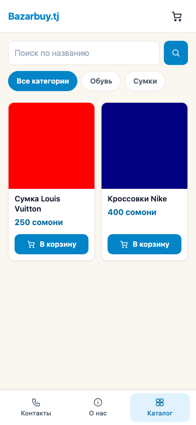
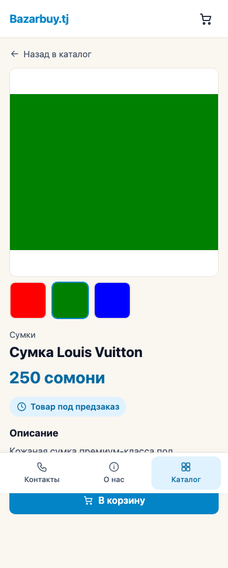
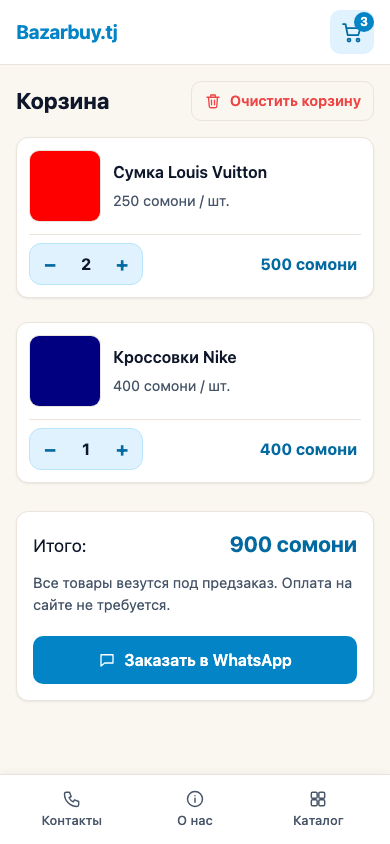
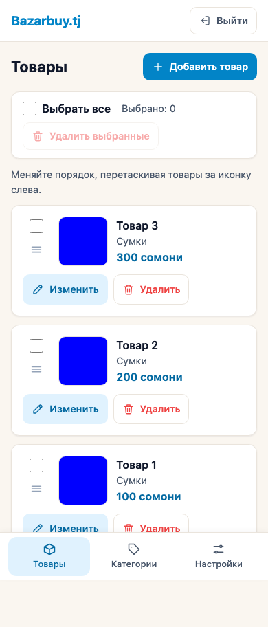

# Bazarbuy.tj

[](https://github.com/rmarufs/bazarbuy/actions/workflows/ci.yml)

Каталог товаров с оформлением предзаказа через WhatsApp без онлайн-оплаты. Покупатель собирает корзину на сайте и отправляет готовое сообщение с заказом владельцу в WhatsApp. Интерфейс спроектирован с приоритетом мобильной версии (mobile-first), валюта — сомони (TJS).

Подробная спецификация проекта: [`docs/SPEC.md`](docs/SPEC.md).

## Возможности

### Покупатель (без регистрации)
- **Каталог:** просмотр карточек товаров, фильтрация по одной категории.
- **Поиск по названию:** без учёта регистра и пробелов (например, `Louis Vuitton`, `louis vuitton` и `LOUISVUITTON` дают одинаковый результат).
- **Карточка товара:** название, описание, цена в сомони, галерея до 5 фото (первое — главное).
- **Корзина в браузере:** хранение в `localStorage`, изменение количества кнопками `+` и `−`, автоматический подсчёт суммы.
- **Заказ через WhatsApp:** генерация ссылки с готовым текстом предзаказа (список позиций, количество, цены и общий итог).
- **Статичные страницы:** «О нас» и «Контакты».

### Админ-панель
- **Авторизация:** вход по логину и паролю через защищённую cookie-сессию (`HttpOnly`, `SameSite=lax`).
- **Управление товарами:** добавление, редактирование и удаление товаров (название, описание, цена, категория, загрузка и удаление до 5 фото).
- **Массовое удаление:** выбор нескольких товаров галочками и удаление одной кнопкой.
- **Порядок показа:** сортировка товаров перетаскиванием (drag-and-drop) за иконку-ручку; новые товары попадают наверх списка.
- **Управление категориями:** создание, переименование и удаление категорий (удаление категории с товарами заблокировано).
- **Настройки:** изменение номера WhatsApp для приёма заказов.

## Скриншоты

| Публичный каталог | Карточка товара | Корзина | Товары в админке |
| :---: | :---: | :---: | :---: |
|  |  |  |  |

## Стек

- **Backend:** Python, FastAPI, Pydantic, async SQLAlchemy + asyncpg, PostgreSQL, Alembic
- **Frontend:** Jinja2-шаблоны, чистый HTML/CSS/JS (без фронтенд-фреймворков)
- **Обработка и хранение изображений:** Pillow, Cloudinary
- **Тестирование:** pytest, pytest-asyncio, Playwright (e2e)

## Установка

Требуется Python 3.12+.

```bash
python3 -m venv .venv
source .venv/bin/activate
pip install -r requirements.txt
playwright install   # только для e2e-тестов
cp .env.example .env # затем заполните значения в .env
```

Для работы приложения и полного прогона тестов нужны две базы данных PostgreSQL: основная и тестовая.

Переменные окружения в `.env` (см. `.env.example`):
- `DATABASE_URL` — строка подключения к основной базе данных PostgreSQL (`postgresql+asyncpg://...`).
- `TEST_DATABASE_URL` — строка подключения к отдельной тестовой базе PostgreSQL (необязательна для запуска самого сайта, нужна для тестов с БД).
- `SECRET_KEY` — секретный ключ для подписи сессионных cookie администратора.
- `APP_ENV` — режим окружения (`development` или `production`; в `production` для сессионной cookie включается флаг `Secure`).
- `CLOUDINARY_CLOUD_NAME` — имя облака (Cloud name) в Cloudinary для загрузки фотографий товаров (необязательно).
- `CLOUDINARY_API_KEY` — API-ключ Cloudinary (необязательно).
- `CLOUDINARY_API_SECRET` — секретный ключ API Cloudinary (необязательно).

### Хранение фотографий

Фотографии товаров хранятся в облачном сервисе **Cloudinary** (для работы достаточно бесплатного тарифа). В базе данных сохраняются только HTTPS-ссылки на загруженные изображения.

Как получить ключи:
1. Зарегистрируйтесь на [cloudinary.com](https://cloudinary.com/).
2. Откройте панель управления (**Dashboard**) и скопируйте значения **Cloud name**, **API key** и **API secret** в соответствующие переменные в `.env`.

Переменные Cloudinary необязательны для запуска приложения: если они не заданы, остальной сайт и админ-панель продолжают работать, но при попытке загрузить фото товара в админке будет показано сообщение «Загрузка изображений не настроена (отсутствуют ключи Cloudinary)». В тестах вызовы Cloudinary автоматически подменяются моками, поэтому для запуска тестов ключи не нужны.

### База данных через Docker (необязательно)

Чтобы не настраивать PostgreSQL локально, обе базы (`bazarbuy` и `bazarbuy_test`) можно поднять одной командой на порту `5433`:

```bash
docker compose up -d
```

После запуска раскомментируйте в `.env` строки с портом `5433` из `.env.example` (заменив ими стандартные `DATABASE_URL` и `TEST_DATABASE_URL`).

Остановка контейнера:

```bash
docker compose down
```

## Запуск

1. Примените миграции базы данных:
   ```bash
   alembic upgrade head
   ```
2. Создайте учётную запись администратора (или обновите пароль существующей):
   ```bash
   python -m app.cli create-admin ЛОГИН ПАРОЛЬ
   ```
3. Запустите сервер разработки:
   ```bash
   uvicorn app.main:app --reload
   ```

Основные адреса после запуска:
- Публичный сайт: http://127.0.0.1:8000/
- Вход в админ-панель: http://127.0.0.1:8000/admin/login
- Проверка состояния сервиса: http://127.0.0.1:8000/health

## Тесты

```bash
pytest             # все тесты (API и e2e)
pytest tests/api   # только API и модульные тесты
pytest tests/e2e   # только браузерные e2e-тесты (Playwright)
```

Проверка кода линтером и форматтером: `ruff check .` и `ruff format --check .`.

Если `TEST_DATABASE_URL` не задан, тесты, которым нужна база данных, автоматически пропускаются (`skipped`).

> **Важно:** во время прогона тесты полностью пересоздают таблицы в тестовой базе данных, поэтому `TEST_DATABASE_URL` обязан отличаться от `DATABASE_URL` (при совпадении тесты остановятся с ошибкой).

## Структура проекта

```text
bazarbuy/
├── alembic/          # миграции базы данных
├── app/
│   ├── core/         # конфигурация, подключение к БД, безопасность, шаблоны
│   ├── models/       # таблицы SQLAlchemy
│   ├── routers/      # HTTP-обработчики (публичные и админские маршруты)
│   ├── schemas/      # схемы Pydantic и валидация данных
│   ├── services/     # вся бизнес-логика приложения
│   ├── static/       # стили CSS и клиентские скрипты JS
│   ├── templates/    # HTML-шаблоны Jinja2
│   ├── cli.py        # CLI-команды (создание администратора)
│   └── main.py       # точка входа FastAPI
├── docs/             # спецификация (SPEC.md) и скриншоты
└── tests/
    ├── api/          # интеграционные и модульные тесты (pytest)
    └── e2e/          # сквозные браузерные тесты (Playwright)
```

Назначение слоёв:
- `app/routers` — только обработка HTTP-запросов и вызов сервисов, без бизнес-логики.
- `app/services` — вся бизнес-логика и работа с данными (фотографии товаров хранятся в Cloudinary через `image_service`).
- `app/models` — модели таблиц SQLAlchemy.
- `app/schemas` — Pydantic-схемы.
- `app/templates`, `app/static` — пользовательский интерфейс.
- `tests/api` — тесты pytest; `tests/e2e` — тесты Playwright.
